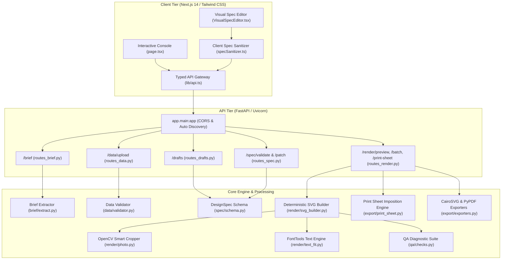

# ACM NIT Surat — Content & Marketing Studio (ID Card Studio)

[](https://www.python.org/)
[](https://fastapi.tiangolo.com/)
[](https://nextjs.org/)
[](https://cairosvg.org/)
[]()

> **Deterministic, code-built, print-ready ID credential studio developed for the ACM NIT Surat Hackathon (Track 4).**  
> Transforms natural-language event briefs and attendee rosters into mathematically precise, vector-sharp ID badges, interactive visual customizations, and commercial print-sheet impositions.

---

## Table of Contents

1. [Executive Summary & Problem Statement](#1-executive-summary--problem-statement)
2. [Solution Overview & Workflow](#2-solution-overview--workflow)
3. [System Architecture](#3-system-architecture)
4. [Key Features & Engineering Highlights](#4-key-features--engineering-highlights)
5. [Technology Stack](#5-technology-stack)
6. [Repository Structure](#6-repository-structure)
7. [Prerequisites & System Setup](#7-prerequisites--system-setup)
8. [Installation Guide](#8-installation-guide)
9. [Environment Configuration](#9-environment-configuration)
10. [Running the Application](#10-running-the-application)
11. [Testing & Quality Gates](#11-testing--quality-gates)
12. [API Reference](#12-api-reference)
13. [Print Readiness & Mechanical Standards](#13-print-readiness--mechanical-standards)
14. [Known Limitations & Roadmap](#14-known-limitations--roadmap)
15. [Team Roles & Ownership](#15-team-roles--ownership)
16. [License](#16-license)

---

## 1. Executive Summary & Problem Statement

### The Problem
Organizing collegiate hackathons, conferences, and technical symposiums involves designing and printing hundreds of personalized participant, mentor, judge, and organizer badges. Current approaches suffer from critical flaws:
- **Generative AI Hallucinations:** Generative image models (e.g. Midjourney, DALL-E) produce raster images with distorted logos, garbled text, fixed resolutions, and zero layout editability.
- **Manual Repetitive Design:** Manual tools (Canva, Photoshop, Illustrator) require painstakingly copy-pasting hundreds of rows or setting up fragile mail-merge workflows that fail on long names, missing photos, or accent characters.
- **Spreadsheet Inconsistency:** Uploaded rosters contain dirty headers, missing attendee names, unknown roles, duplicate IDs, and irregular photo aspect ratios.
- **Print Defect Disasters:** Designers overlook mechanical print parameters—lacking 3 mm bleed margins, breaching 4 mm safe zones, generating sub-300 DPI exports, or using low-contrast color palettes that are unreadable in black-and-white printouts.

### The Solution: Non-Negotiables & Core Philosophy
ACM NIT Surat ID Card Studio rejects generative image models in favor of a **code-driven, deterministic SVG rendering pipeline grounded in a single Design Spec**:
1. **Designs are Pure Data:** Every card design is composed of a `LayoutSpec` JSON (spatial coordinates, bounding boxes, element types) and a `ThemeSpec` JSON (semantic color tokens, font families, role color maps). Layouts reference token names (`primary`, `background`, `accent`, `text`), never hardcoded hex values.
2. **Deterministic & Reproducible:** `Same Spec + Same Attendee Record = Identical Pixel/Vector Output`.
3. **Mechanical Print Precision:** Rendered natively in millimeters (`mm`) with a 54 × 86 mm finished trim (CR80 standard), 3 mm print bleed (60 × 92 mm canvas), 4 mm safe margin (x: 7..53 mm, y: 7..85 mm), and 300+ DPI vector/raster export.
4. **Authentic Institutional Branding:** Authentic SVNIT and ACM NIT Surat vector logos are embedded with fixed aspect ratios (`fit: contain`) and protected clearance zones.
5. **AI with Boundaries:** Large Language Models (Gemini API) are restricted strictly to unstructured text extraction and semantic parameter patching. AI never generates pixels, never invents dates or venues, and never places text. Unknown inputs remain `null` and trigger structured clarification prompts.

---

## 2. Solution Overview & Workflow

The platform bridges event ideation and physical credential distribution through a seamless 5-stage pipeline:

```text
[ 1. Event Brief ] ──► Natural-language extraction (Gemini) with offline rule-based fallback
        │
[ 2. Clarification ] ─► Identifies missing mandatory fields & generates structured Q&A
        │
[ 3. Attendee Roster ] ─► CSV loading, fuzzy header normalization, duplicate ID & role validation
        │
[ 4. Design Catalog ] ─► Deterministic 3x3 Layout × Theme generation with role-based differentiation
        │
[ 5. Visual Studio ] ──► Interactive WYSIWYG editor (reposition, resize, fonts, colors, decals)
        │
[ 6. Automated QA ] ──► Real-time WCAG 2.1 contrast, text overflow, overlap, and DPI diagnostics
        │
[ 7. Production Export ] ► Multi-page collated PDF, individual PNG/SVG ZIP, and imposed A4/A3 print sheets
```

---

## 3. System Architecture

The project consists of an asynchronous **FastAPI backend** managing data validation, Pydantic schemas, and native rendering, paired with a modern **Next.js 14 frontend** delivering a real-time visual design console.



---

## 4. Key Features & Engineering Highlights

### 1. Intelligent Brief Ingestion & Fallback
- Accepts conversational prompts (e.g., *"24-hour hackathon on 18 October at SVNIT for 200 participants, 20 mentors, 15 organizers"*).
- Uses Google Gemini API to structure data into a typed `Brief` Pydantic model (`event_name`, `tagline`, `dates`, `venue`, `roles`, `style_hint`).
- **Zero-Failure Offline Fallback:** If `GEMINI_API_KEY` is omitted or API quotas are exceeded, an internal heuristic regex extractor automatically runs with zero interruption.
- Automatically computes missing required information and prompts the organizer with actionable questions.

### 2. Robust CSV Attendee Roster Validation
- Ingests raw CSV rosters and maps heterogeneous column headers (`Full Name`, `Name`, `Participant`, `Role`, `Category`, `Photo URL`, `Email`).
- Detects fatal anomalies: missing names, duplicate attendee IDs, invalid or unconfigured roles.
- Flags non-fatal warnings: unusually long names (>30 chars), invalid email formats, and missing attendee photographs.

### 3. Deterministic Design Catalog & Spec Freeze
- Combines 3 layout architectures (`classic`, `minimal`, `split`) with 3 curated themes (`clean_light`, `dark_tech`, `bold_event`).
- Strictly adheres to the **Day-1 Spec Freeze**: layouts specify element boxes and theme token bindings (`fill: "background"`, `stroke: "primary"`), while themes define color palettes and typography.
- Role-based differentiation: Attendees are color-coded and badged by role (`participant`, `organizer`, `mentor`, `volunteer`) using high-contrast token palettes.

### 4. Interactive Visual Design Studio
- Built-in visual editor enabling organisers to click, drag, nudge, and resize any card element.
- Typography engine: Switch between Google Fonts (`Poppins`, `Inter`, `Bebas Neue`, `Chakra Petch`, `Rajdhani`, `Space Grotesk`) with real-time text wrapping and sizing preview.
- **Card Background & Transparency:** Choose between any solid hex color or true alpha transparency (`fill="none"`) with an on-canvas checkerboard preview.
- **Asset Uploads & Decals:** Upload custom institutional logos, watermarks, circuit line vectors, or tech badges, with layering controls and opacity sliders.

### 5. Algorithmic Layout Engine & Dynamic Typography
- **Text Auto-Fit:** Utilizes Pillow/FontTools font metric calculation. Calculates actual glyph dimensions; if an attendee name exceeds bounds, the engine dynamically steps down font size from `max_font` to `min_font`, wraps across multiple lines, and safely truncates if necessary without breaking layout geometry.
- **OpenCV Face-Centered Photo Cropping:** Detects facial landmarks in uploaded portrait photos to center faces within circular or rounded rectangular frames, eliminating awkward forehead or chin cuts. Falls back to crisp typographic initials avatars if photos are missing.

### 6. Automated Quality Assurance (QA) Suite
Runs automatically before any card is approved for export:
- **WCAG 2.1 Contrast Ratio:** Computes foreground-to-background contrast ratios, verifying compliance with 4.5:1 (AA) and 7:1 (AAA) thresholds.
- **Safe Area Inset Enforcement:** Verifies that all textual content stays within the 4 mm safe margin (`x: 7..53 mm`, `y: 7..85 mm`).
- **Logo Proportions:** Guarantees institutional logos maintain their exact native aspect ratio without distortion.
- **Resolution Verification:** Flags raster photographs whose effective print resolution falls below 300 DPI at physical card dimensions.
- **Element Collision Detection:** Flags overlapping text or graphics.

### 7. Commercial Print & Batch Export
- **Collated Multi-Page PDF:** Assembles all cards into a single vector PDF (1 card per page) at exact 60 × 92 mm dimensions with embedded fonts.
- **Individual ZIP Bundles:** Generates high-resolution 300 DPI PNGs or raw SVG files accompanied by a structured `report.json` auditing print metadata.
- **Commercial Print Sheet Imposition:** Imposes cards into print grids on standard paper stocks:
  - **A4 Sheet:** 3 × 3 grid (9 cards per sheet) or 2 × 4 grid (8 cards per sheet).
  - **A3 Sheet:** 4 × 4 grid (16 cards per sheet).
  - Includes vector crop/trim tick marks, registration marks, and configurable inter-card gutters.

---

## 5. Technology Stack

| Tier / Subsystem | Technologies Used | Purpose |
| :--- | :--- | :--- |
| **Frontend Framework** | Next.js 14 (App Router), React 18, TypeScript | High-performance, SSR/client hybrid UI console |
| **Styling & Components** | Tailwind CSS, Lucide React icons | Minimalist Midnight Aurora dark design system |
| **Backend API** | Python 3.10+, FastAPI, Uvicorn | High-throughput async REST API with auto route discovery |
| **Data Validation** | Pydantic v2, Pandas | Type-safe JSON schemas, RFC 6902 patch validation, CSV ingestion |
| **Card Rendering** | Jinja2, SVG XML DOM, FontTools | Exact mm-coordinate vector SVG construction |
| **Export Engines** | CairoSVG, Pillow (PIL), PyPDF, ReportLab | Headless vector-to-PDF, 300 DPI PNG rasterization, sheet imposition |
| **Computer Vision** | OpenCV (`opencv-python-headless`) | Face-aware photo cropping and bounding box centering |
| **Barcodes & QR** | Segno, QRCode | ISO/IEC 18004 vector QR code generation with quiet zones |
| **AI Extraction** | Google Gemini API (`google-genai`) | Natural-language brief extraction & spec refinement |
| **Test Automation** | Pytest, HTTPX, Jest / Next.js Test | 230 automated unit, integration, and security tests |

---

## 6. Repository Structure

```text
content-marketing-studio/
├── README.md                           # Master project documentation & judge guide
├── .gitignore                          # Clean repository ignore rules
├── .env.example                        # Template for optional API credentials
├── .devcontainer/                      # Docker / Codespaces configuration
│   └── devcontainer.json               # Auto-provisions Cairo, Python, & Node.js
├── backend/                            # FastAPI backend application
│   ├── app/
│   │   ├── main.py                     # Canonical API entry point & CORS configuration
│   │   ├── config.py                   # Global path constants & mm canvas geometry
│   │   ├── api/                        # REST endpoint routers
│   │   │   ├── routes_brief.py         # POST /brief (Gemini extraction & Q&A)
│   │   │   ├── routes_data.py          # POST /data/upload (CSV validation)
│   │   │   ├── routes_drafts.py        # POST /drafts (Deterministic generation)
│   │   │   ├── routes_spec.py          # POST /spec/validate & /spec/patch
│   │   │   ├── routes_render.py        # POST /render/preview, /batch, /print-sheet
│   │   │   ├── routes_templates.py     # GET /templates/layouts & /templates/themes
│   │   │   └── routes_health.py        # GET /health
│   │   ├── brief/                      # Brief extraction & missing info heuristics
│   │   ├── data/                       # CSV loading, normalization, & validation
│   │   ├── generator/                  # Deterministic Layout x Theme draft generator
│   │   ├── render/                     # Canonical SVG builder, text fitting, QR codes
│   │   ├── export/                     # Print-sheet imposition, PDF/PNG conversion
│   │   ├── qa/                         # Automated QA contrast, overflow, & logo checkers
│   │   ├── refine/                     # Spec patch operations & validation
│   │   ├── spec/                       # Pydantic schemas (DesignSpec, Page, Theme, Layout)
│   │   └── templates/                  # Canonical layout JSONs & theme JSONs
│   ├── requirements.txt                # Unified requirements loader
│   ├── requirements/                   # Role-divided package manifests
│   ├── scripts/                        # Verification & sample data generation utilities
│   │   ├── check_env.py                # System capability verification script
│   │   ├── check_ownership.py          # Git multi-developer ownership validator
│   │   ├── make_sample_data.py         # 250-attendee realistic test data generator
│   │   └── preview.py                  # CLI visual proof generator
│   └── tests/                          # Backend Pytest test suites (199 passed)
├── frontend/                           # Next.js 14 web application
│   ├── app/
│   │   ├── page.tsx                    # Main 5-step console & production studio
│   │   ├── editor/page.tsx             # Standalone full-screen visual editor
│   │   ├── layout.tsx                  # Root HTML layout with Google Inter typography
│   │   └── api/upload-asset/route.ts   # Client-side custom decal upload handler
│   ├── components/
│   │   └── VisualSpecEditor.tsx        # Interactive SVG visual canvas editor
│   ├── lib/
│   │   ├── api.ts                      # Typed client calling FastAPI endpoints
│   │   ├── csv.ts                      # Client-side CSV parsing & diagnostics
│   │   └── specSanitizer.ts            # Spec validation & guaranteed layer indexing
│   ├── public/                         # Public web assets (SVNIT & ACM vector logos)
│   ├── package.json                    # Frontend scripts & dependencies
│   └── tsconfig.json                   # Strict TypeScript configuration
├── assets/                             # Master static branding assets
│   ├── logos/                          # High-res SVNIT and ACM NIT Surat SVG/PNG logos
│   └── fonts/                          # SIL Open Font License TrueType binaries
├── sample_data/                        # Test fixtures & test attendee photos
│   ├── people_realistic.csv            # Clean multi-role sample data
│   ├── people_messy.csv                # Edge cases (long names, missing values, duplicates)
│   └── photos/                         # Test portrait images for face-crop testing
├── export/                             # Shared export CLI & batch modules
├── qa/                                 # Shared QA checkers & report formatters
├── render/                             # Shared modular SVG rendering components
└── docs/                               # Architecture, team contracts, & specs
    ├── DESIGN_SPEC.md                  # Canonical Design Spec specification
    ├── OWNERS.json                     # Conflict-free code ownership mapping
    ├── PROJECT_CONTEXT.md              # Hackathon track rules & non-negotiables
    └── API_CONTRACT.md                 # REST API input/output specification
```

---

## 7. Prerequisites & System Setup

### Required Runtimes
- **Python:** Version `3.10` or higher (`3.11` / `3.12` / `3.13` supported).
- **Node.js:** Version `18.17` or higher (`20 LTS` recommended).
- **Git:** Version `2.30+`.

### Native System Graphics Libraries (Required for CairoSVG)
CairoSVG requires the native Cairo and GObject system libraries to render vector graphics to PDF and PNG:
- **Windows:** Install GTK3 runtime via Conda (`conda install cairo`), MSYS2, or download the [GTK3 for Windows runtime installer](https://github.com/tschoonj/GTK-for-Windows-Runtime-Environment-Installer/releases).
- **macOS:** `brew install cairo pango libpng`
- **Ubuntu / Debian:** `sudo apt update && sudo apt install -y libcairo2 libpango-1.0-0 libgl1 libglib2.0-0`

---

## 8. Installation Guide

Follow these exact steps from the root of the repository:

### 1. Backend Environment Setup
```bash
# 1. Create a Python virtual environment
python -m venv .venv

# 2. Activate the virtual environment
# Windows (PowerShell):
.venv\Scripts\Activate.ps1
# Windows (Command Prompt):
.venv\Scripts\activate.bat
# macOS / Linux:
source .venv/bin/activate

# 3. Install backend dependencies
cd backend
pip install -r requirements.txt

# 4. Verify system environment readiness
python scripts/check_env.py
```
*Expected output: `0 failed, 23 passed`.*

### 2. Frontend Setup
```bash
# From the repository root:
cd frontend
npm install
```

---

## 9. Environment Configuration

Copy the example environment template:

```bash
# From repository root:
cp .env.example .env
```

Edit `.env` to configure your settings:

```ini
# Optional: Google Gemini API key for natural language brief extraction & refinement.
# If left blank or unset, the application operates in 100% offline deterministic mode.
GEMINI_API_KEY=your_gemini_api_key_here

# Backend service port (default: 8000)
PORT=8000

# Frontend API gateway target (default: http://localhost:8000)
NEXT_PUBLIC_API_URL=http://localhost:8000
```

> **Security Note:** Real API keys or credentials must never be committed to Git. The `.gitignore` is pre-configured to exclude all `.env` files.

---

## 10. Running the Application

For the full interactive studio experience, run both the backend and frontend concurrently:

### Terminal 1: Start the FastAPI Backend
```bash
# Ensure virtual environment is active
cd backend
python -m uvicorn app.main:app --port 8000 --reload
```
- **Backend Service:** `http://localhost:8000`
- **Interactive Swagger Docs:** `http://localhost:8000/docs`
- **OpenAPI JSON Specification:** `http://localhost:8000/openapi.json`

### Terminal 2: Start the Next.js Frontend
```bash
cd frontend
npm run dev
```
- **Web Studio Console:** `http://localhost:3000`
- **Visual Editor Route:** `http://localhost:3000/editor`

---

## 11. Testing & Quality Gates

The repository enforces strict verification through automated test suites and ownership checks:

### 1. Run Complete Python Test Suite
```bash
# From backend/ directory:
python -m pytest
```
*Result: **199 passed** tests verifying API contracts, Pydantic schemas, CSV loaders, draft generation, SVG builders, OpenCV photo cropping, QA rules, and PDF exports.*

### 2. Run Root Exporter & QA Test Suite
```bash
# From repository root:
python -m pytest tests/test_export.py tests/test_qa.py
```
*Result: **31 passed** tests verifying physical dimensions, DPI pixel accuracy, and WCAG contrast checks.*

### 3. Verify Code Ownership Rules
```bash
# From backend/ directory:
python scripts/check_ownership.py --owner p1
```
*Result: Verifies all changed and untracked files strictly adhere to team ownership boundaries in `docs/OWNERS.json`.*

### 4. Run Frontend Production Build & Typecheck
```bash
# From frontend/ directory:
npm run build
npm run lint
```
*Result: Next.js compiled successfully with zero TypeScript or ESLint errors.*

---

## 12. API Reference

All backend endpoints are fully documented and testable via the interactive Swagger UI at `http://localhost:8000/docs`.

| Method | Endpoint | Description | Request Payload / Params | Response Summary |
| :--- | :--- | :--- | :--- | :--- |
| `GET` | `/health` | Service liveness probe | None | `{"status": "ok", "version": "0.0.1"}` |
| `POST` | `/brief` | Extract brief & missing questions | `{"prompt": "string"}` | `Brief` model + follow-up questions array |
| `POST` | `/data/upload` | Validate attendee CSV file | `multipart/form-data` (file) | Valid rows, warnings, and error counts |
| `POST` | `/drafts` | Deterministically generate 3 design drafts | `Brief` model | Array of 3 valid `DesignSpec` objects |
| `POST` | `/spec/validate` | Validate spec syntax & tokens | `DesignSpec` JSON | Validation status and diagnostic warnings |
| `POST` | `/spec/patch` | Apply RFC 6902-style patches | `{"spec": {...}, "patches": [...]}` | Updated `DesignSpec` or rollback error |
| `POST` | `/render/preview` | Render single SVG badge with data | `RenderPreviewRequest` (spec, person, guides) | `{"svg": "<svg...>...</svg>", "issues": [...]}` |
| `POST` | `/render/batch` | Bulk render all attendees | `RenderBatchRequest` (spec, attendees, format) | Multi-page PDF binary or ZIP archive |
| `POST` | `/render/print-sheet` | Generate imposed commercial print sheet | `RenderPrintSheetRequest` (spec, attendees, paper) | Print-ready PDF or SVG with crop marks |
| `GET` | `/templates/layouts` | List available layout templates | None | `["classic", "minimal", "split"]` |
| `GET` | `/templates/themes` | List available theme templates | None | `["clean_light", "dark_tech", "bold_event"]` |
| `GET` | `/roles` | List configured roles & badges | None | Array of role definitions from `roles.json` |

---

## 13. Print Readiness & Mechanical Standards

Every card rendered by this system conforms to international commercial printing standards:

```text
+-----------------------------------------------------------+ ── Origin (0,0) [Canvas 60 x 92 mm]
| 3 mm Bleed Margin (Excess trimmed off during guillotine)  |
|   +---------------------------------------------------+   | ── Trim Line (54 x 86 mm Finished Badge)
|   | 4 mm Safe Inset Margin                            |   |
|   |   +-------------------------------------------+   |   | ── Safe Area Boundary (x: 7..53, y: 7..85 mm)
|   |   |                                           |   |   |
|   |   |   [ACM Logo]                 [SVNIT Logo] |   |   |
|   |   |                                           |   |   |
|   |   |                [Photo Frame]              |   |   |
|   |   |                                           |   |   |
|   |   |              ATTENDEE NAME                |   |   |
|   |   |              [ ROLE BADGE ]               |   |   |
|   |   |                                           |   |   |
|   |   |   [Team / ID]                   [QR Code] |   |   |
|   |   +-------------------------------------------+   |   |
|   +---------------------------------------------------+   |
+-----------------------------------------------------------+
```

- **Physical Trim Size:** 54.0 × 86.0 mm (ISO/IEC 7810 ID-1 standard).
- **Bleed Allowance:** 3.0 mm on all 4 sides (total canvas 60.0 × 92.0 mm).
- **Safe Zone:** 4.0 mm inset from the trim line. All critical typography and QR codes are strictly bounded within `x: 7..53 mm`, `y: 7..85 mm`.
- **Target Resolution:** 300 DPI minimum for all rasterized outputs (709 × 1087 pixels at 60 × 92 mm canvas).
- **Font Embedding:** TrueType fonts are embedded directly into generated PDFs and converted to path outlines where necessary for zero font-substitution defects.

---

## 14. Known Limitations & Roadmap

### Current Limitations
1. **In-Memory Session Persistence:** Custom design layouts and attendee rosters are persisted in browser `localStorage` and React state. Server-side SQLite persistence is scaffolded in `backend/app/storage.py` but not wired to primary endpoints.
2. **Single-Side Cards:** Currently optimized for single-sided portrait ID cards. Double-sided lanyard printing (front + back with terms and conditions) is planned.
3. **Photo URL Remote Fetching:** Remote image links in CSV rosters require local caching; network timeouts during batch rendering fallback to typographic initials.

### Roadmap
- [ ] **Lanyard & Clip 3D Mockup Preview:** Three.js photorealistic 3D badge preview with physical fabric lanyards.
- [ ] **Double-Sided Card Support:** Add backside layout templates for conference agendas, emergency contacts, and Wi-Fi credentials.
- [ ] **Certificate & Poster Module:** Expand the same underlying DesignSpec architecture to issue dynamic event certificates and promotional posters.
- [ ] **Full SQLite Database Storage:** Complete CRUD persistence for multi-event organizers.

---

## 15. Team Roles & Ownership

This project was built by a 4-person collaborative team with strict ownership isolation defined in [`docs/OWNERS.json`](file:///c:/Users/ANUBHAV/Downloads/workspace-01a11561-eca6-7528-8b22-be365d148db8/docs/OWNERS.json):

| Role | Domain | Responsibilities & Core Files |
| :--- | :--- | :--- |
| **Person 1** | Backend Foundations & AI | Design Spec schemas, Gemini API brief extraction, CSV validation, FastAPI app router, repo configurations (`backend/app/`, `tests/p1/`, `docs/p1/`). |
| **Person 2** | Rendering, QA & Export | SVG builder engine, text auto-fitting, OpenCV photo crop, QA validators, CairoSVG/PyPDF exporters (`render/`, `qa/`, `export/`, `tests/p2/`). |
| **Person 3** | Frontend Web Studio | Next.js 14 console, interactive Visual Spec Editor, client sanitizers, Tailwind CSS design system (`frontend/`, `docs/p3/`). |
| **Person 4** | Visual Design & Assets | Layout templates (`classic`, `minimal`, `split`), theme tokens (`clean_light`, `dark_tech`, `bold_event`), SVNIT/ACM logos, fonts (`assets/`, `sample_data/`). |

---

## 16. License

This project is licensed under the [MIT License](https://opensource.org/licenses/MIT).  
Typography assets under `assets/fonts/` are licensed under the [SIL Open Font License 1.1](file:///c:/Users/ANUBHAV/Downloads/workspace-01a11561-eca6-7528-8b22-be365d148db8/assets/fonts/OFL.txt).
All institutional trademarks and logos belong to ACM NIT Surat and Sardar Vallabhbhai National Institute of Technology (SVNIT), Surat.
